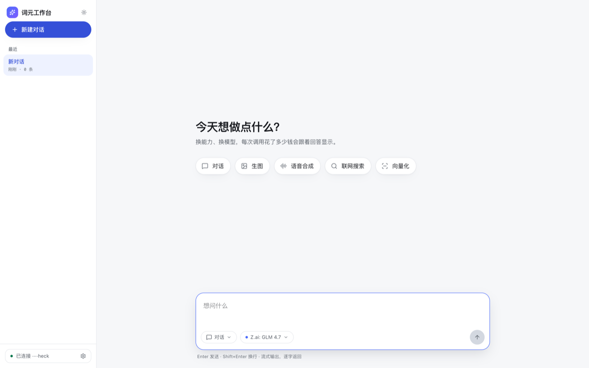
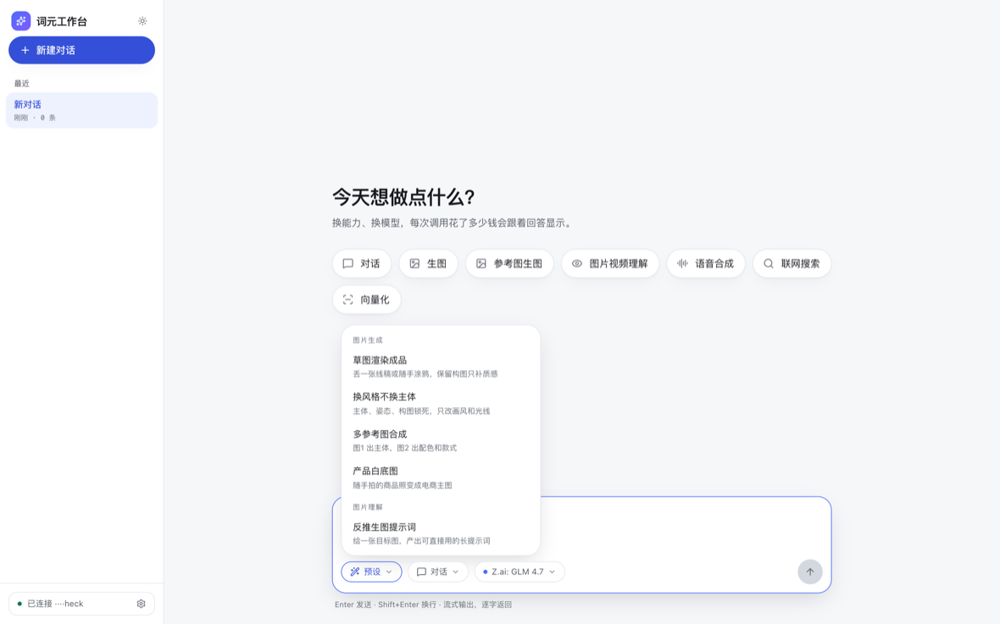
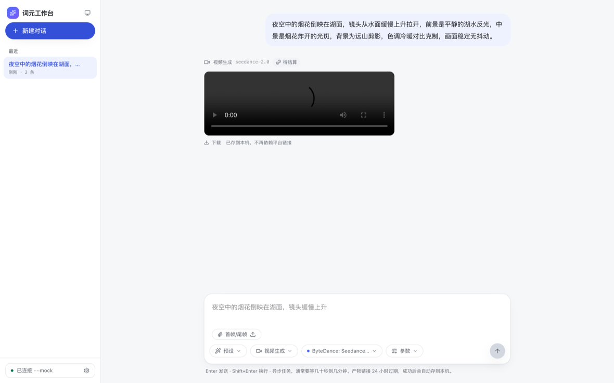

# 词元工作台 · TokenDance Workbench

一个**零后端**的 AI 能力工作台网页应用：浏览器直连 [词元跳动](https://tokendance.space) 网关，
在自己的对话界面里调用 108 个模型和多种协议，并且能看见每一次调用花了多少钱。

浅色 / 深色双主题，豆包式的会话布局，会话记录存本机。

| 空状态 | 预设菜单 | 会话与产物 |
| --- | --- | --- |
|  |  |  |

## 30 秒跑起来

```bash
npm install
npm run dev
```

打开 http://localhost:5173 ，点左下角「连接 Token 钱包」完成 OAuth 授权，
或者在设置面板里直接粘贴一个 API Key。

## 为什么不需要后端

词元跳动网关对浏览器开放跨域：`access-control-allow-origin: *`。
所以这个仓库里没有 server、没有 Docker、没有数据库，`npm run build` 出来的静态文件
丢到任何静态托管上就能用。

代价是两条硬约束，写在这里省得你踩：

1. **API Key 存在浏览器里**（默认 sessionStorage，关标签页即失效；勾选持久化才写 localStorage）。
   这是 BYOK 网页应用的固有边界，不要把它当成安全的密钥管理方案。
2. **带自定义请求头的协议调不通**。网关的预检只放行固定一组头，实测结论：
   - 豆包语音合成（`ark:tts`）需要 `X-Api-Resource-Id` → 不放行，浏览器直连用不了，
     所以语音走 MiniMax `t2a_v2`（标准头，同步返回）。
   - Anthropic Messages 需要 `anthropic-version` → 不放行，视觉理解走 OpenAI chat 协议。
   - `/portal/*` 只放行 `Authorization,Content-Type`，**归因头 `X-App-URL` 只能加在 `/gateway/*` 上**。

## 已接入的能力

能力清单在 `src/lib/capabilities/index.ts`，当前 8 个：

| 能力 | 协议 | 模型数 | 形态 |
| --- | --- | --- | --- |
| 对话 | `openai:chat-completions` | 71 | SSE 流式 |
| 生图 | `openai:image-generations` | 1 | 同步 |
| 参考图生图 | `ark:image-generations` | 2 | 同步，支持 Data URL 参考图 |
| 图片视频理解 | `openai:chat-completions` | 8 个视觉模型 | SSE 流式 |
| 视频生成 | `seedance:generations` | 4 | 异步任务 + 轮询 |
| 语音合成 | `minimax:t2a_v2` | 2 | 同步，hex 音频转 mp3 |
| 联网搜索 | `bocha:web-search` | 1 | 同步 |
| 向量化 | `openai:embeddings` | 2 | 同步 |

模型池不写死，运行时从 `GET /gateway/v1/models` 按 `supported_protocols` 过滤。

## 加一个能力（唯一的扩展点）

在 `src/lib/capabilities/` 新建一个文件，实现 `Capability` 接口，然后 push 进注册数组：

```ts
export const myCap: Capability = {
  id: 'my-cap',
  label: '我的能力',
  protocol: 'openai:chat-completions', // 必须与模型目录里的字面量一致
  hint: '一句话说清形态',
  icon: 'sparkles',
  fields: [{ name: 'prompt', label: '提示词', kind: 'textarea' }],
  run: async (input) => ({ text: '…', meta }),
}
```

输入框的模式菜单、空状态入口会自己出现，不用改任何组件。
异步协议实现 `submit` + `poll`，任务轮询、产物落盘、刷新续跑由 `App.tsx` 统一负责。

预设（写好的提示词 + 素材要求）在 `src/lib/presets.ts`，加一条就多一个玩法。
图片类预设的提示词结构参考了 [wuyoscar/GPT-Image2-Skill](https://github.com/wuyoscar/GPT-Image2-Skill)
里的 `get-prompt-from-image`（视觉锚点前置、说清媒介边界、品牌 IP 翻译成形状配色、负面词单列），是重写不是照搬。

## 关于归因和 TokenPay

`X-App-URL` 是应用归因的唯一要素，**申请 TokenPay 之后不可变更**，改了归因就断。
所以 fork 这个项目做自己的产品时，第一件事是把 `src/lib/config.ts` 里的
`DEFAULT_APP_URL` 换成你自己的、且全局唯一的值，别留示例值。

## 验证状态（说清楚哪些是真跑过的）

已在真实浏览器里验证：

- 模型目录跨域加载、能力过滤、主题切换与对比度（WCAG AA 实测）
- 401 错误链路 → 解析错误码 → 提示重新授权并自动展开设置
- 视频抽帧：本地 mp4 → 8 帧 → 请求体确实带 8 个 `data:image/jpeg`
- 异步任务状态机：用请求拦截伪造 `running → succeeded`，轮询次数、IndexedDB 落盘、
  播放源切换成本机 blob 全部符合预期

**未验证**（需要真实 API Key 和额度）：

- 任何一次真实模型调用的返回内容与计费
- 视觉输入用的 `messages[].content` + `image_url` 结构：网关文档没写，按 OpenAI 规范透传
- Seedance 提交响应里的任务 ID 字段名：文档没给示例，代码按 `id` / `task_id` 容错读
- 异步任务的消耗核算（依赖余额接口）

## 本地数据

| 位置 | 内容 |
| --- | --- |
| sessionStorage | API Key（默认） |
| localStorage | 主题、APP URL、会话记录 |
| IndexedDB | 视频产物字节（对抗 24 小时链接过期） |

## License

待定。
